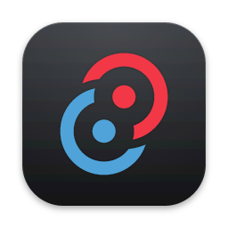
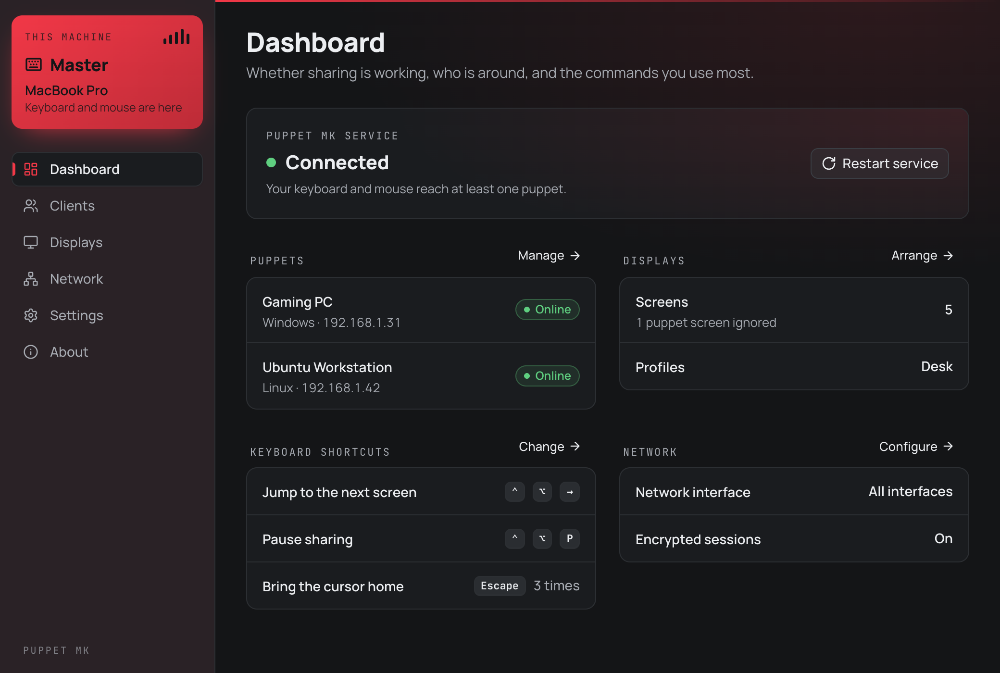
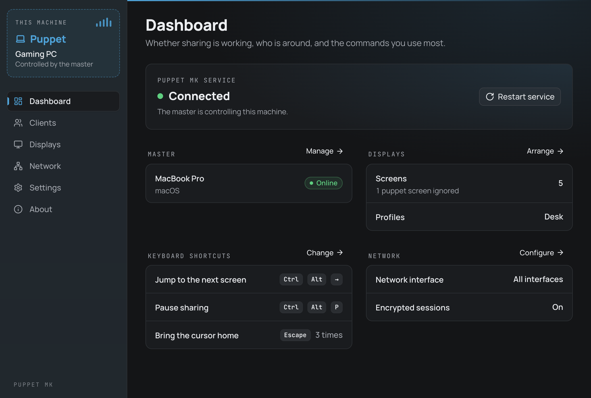
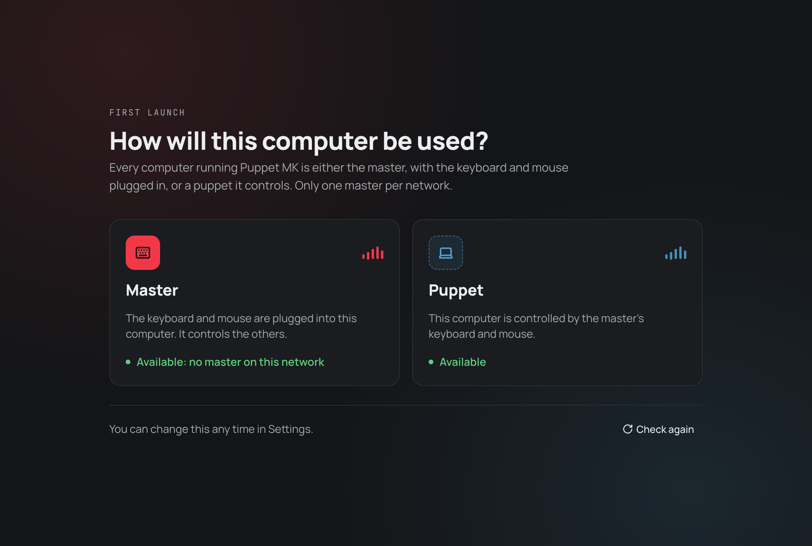
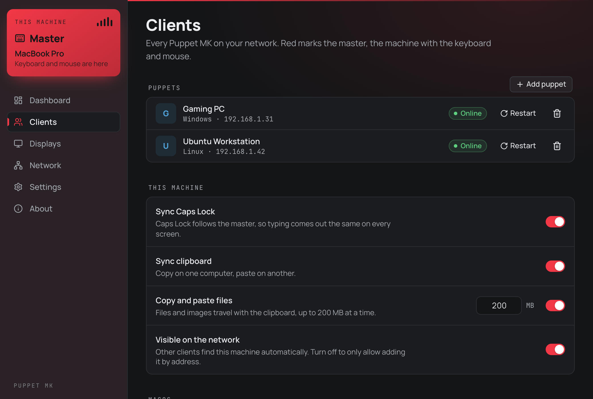
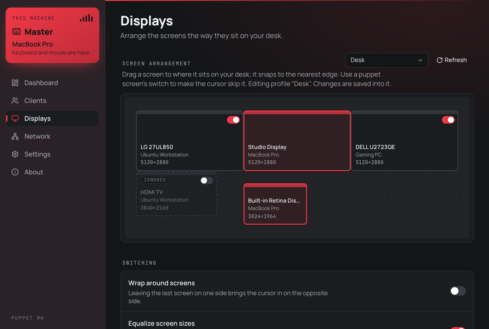
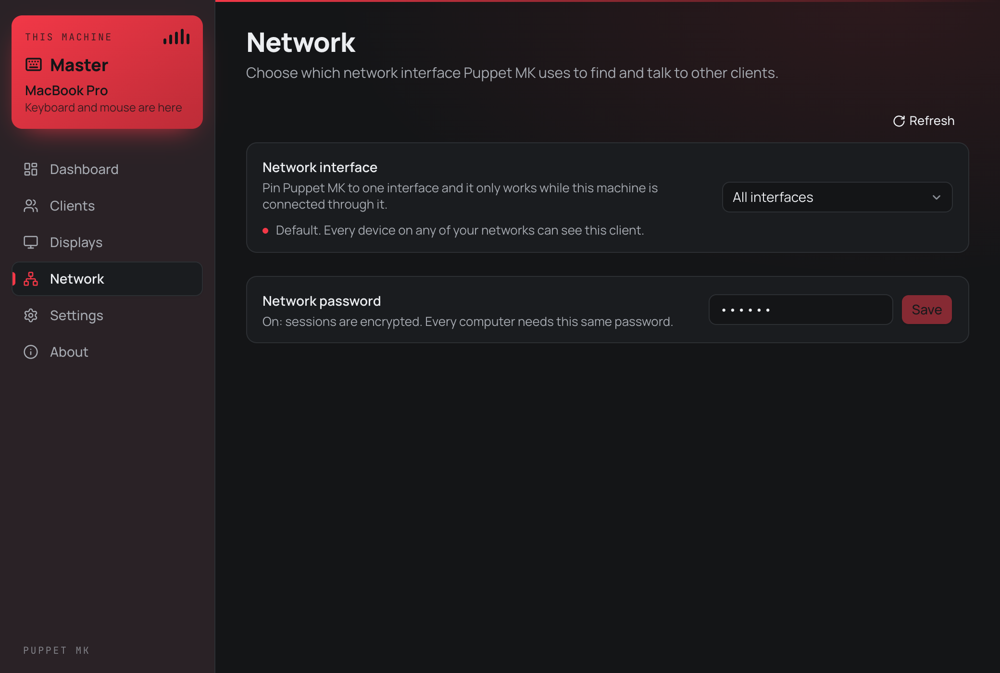
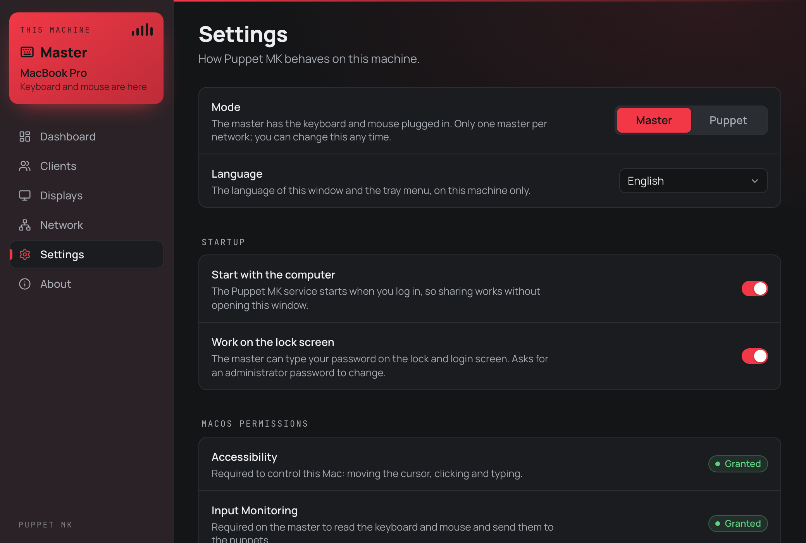

<p align="center">
  
</p>

<h1 align="center">Puppet Mouse Keyboard</h1>

<p align="center">
  <a href="https://github.com/danillo-ao/puppet-mk-releases/releases/latest"></a>
  <a href="https://github.com/danillo-ao/puppet-mk-releases/releases/latest"></a>
  <a href="https://github.com/danillo-ao/puppet-mk-releases/releases"></a>
  
  
  
  
</p>

<p align="center">
  <strong>English</strong> · <a href="readme.pt-br.md">Português (Brasil)</a>
</p>

Share one keyboard and mouse between all the computers on your desk, over your local network.

Move the cursor off the edge of one screen and it shows up on the next computer, as if every machine were one big desktop. Your keyboard, Caps Lock, clipboard and files follow it. Puppet MK runs on **macOS**, **Windows** and **Linux**, and the computers can mix systems.



## Download

Get the latest version from the [Releases page](../../releases/latest).

| System | File |
| --- | --- |
| macOS (Apple Silicon) | `Puppet.MK_<version>_aarch64.dmg` |
| Windows (64-bit) | `Puppet.MK_<version>_x64-setup.exe` |
| Linux (64-bit, Debian / Ubuntu) | `Puppet.MK_<version>_amd64.deb` |

Install Puppet MK on **every** computer you want to share the keyboard and mouse with.

## How it works

Each computer running Puppet MK is a **client**, and each client plays one of two roles:

- **Master**: the computer with the keyboard and mouse plugged in. There is only one master per network. It is shown in **red**.
- **Puppet**: a computer controlled by the master. It is shown in **blue**.

You can switch roles at any time in **Settings**.

| Master | Puppet |
| --- | --- |
|  |  |

## Getting started

1. **Install** Puppet MK on each computer (see [Platform notes](#platform-notes)).
2. **Choose a role.** On first launch, Puppet MK asks how the computer will be used. Pick **Master** on the computer with the keyboard and mouse, and **Puppet** on the others.

   

3. **Add your puppets.** On the master, open **Clients** and click **Add puppet**. Puppets on the same network are found automatically; if one doesn't show up, add it by its IP address.
4. **Arrange your screens.** Open **Displays** and drag each screen to where it sits on your desk.
5. **Move the mouse** across a screen edge. That's it.

## Features

### Clients

The master lists every puppet with its status, and can restart a puppet's service or remove it. Each machine also controls how it behaves:

- **Sync Caps Lock**: Caps Lock follows the master, so typing comes out the same on every screen.
- **Sync clipboard**: copy on one computer, paste on another.
- **Copy and paste files**: files and images travel with the clipboard (up to 200 MB at a time).
- **Visible on the network**: turn off to only allow adding this machine by its address.
- **macOS modifier keys**: remap Command, Control, Option and Shift. By default the Windows key acts as Command.

Settings made on the master are synced to every connected client.



### Displays

Drag screens to match your desk; they snap to the nearest edge. Screens with different resolutions work together.

- **Profiles**: save several layouts (for example *Desk* and *Travel*) and switch between them.
- **Ignore a screen**: switch off a puppet screen and the cursor skips it. It stays on the canvas, greyed out.
- **Wrap around screens** and **Equalize screen sizes** for smoother movement between monitors.



### Network

- **Network interface**: by default Puppet MK works on every network. Pin it to one interface (for example your home Wi-Fi) and it only works while connected through it.
- **Network password**: set the same password on every computer to encrypt the sessions.



### Settings

- **Start with the computer**: the service runs at login, without opening the window.
- **Work on the lock screen**: the master can type your password on the lock and login screen (on macOS it asks for an administrator password; on Linux it is always on; not available on Windows yet).
- **Prevent switching**: keep the cursor on the current computer in screen corners, full-screen apps, maximized windows, or **while a mouse button is held**, so a drag never jumps to another computer by accident.
- **Keyboard shortcuts**: jump to the next screen, or pause sharing.
- **Panic key**: press a key a few times in a row (by default `Esc` twice) to bring the cursor back to the center of the master's screen.
- **Language**: English or Português (Brasil).
- **Updates**: check for and install new versions automatically.



### Menu bar and tray

Puppet MK keeps running in the background after you close the window. Its icon in the macOS menu bar, or in the system tray on Windows and Linux, shows whether the service is connected, running or stopped.

## Platform notes

### macOS

1. Open the `.dmg` and drag **Puppet MK** to **Applications**.
2. The first time you open it, macOS may say it can't verify the developer. Go to **System Settings → Privacy & Security** and click **Open Anyway**.
3. Grant the permissions Puppet MK asks for in **System Settings → Privacy & Security**:
   - **Accessibility**: needed to move the cursor, click and type on this Mac.
   - **Input Monitoring**: needed on the master to read the keyboard and mouse.

   **Settings → macOS permissions** in Puppet MK shows whether each one is granted.

Updates keep the same signature, so you don't need to grant the permissions again after updating.

### Windows

1. Run the `-setup.exe` installer.
2. If Windows SmartScreen shows a warning, click **More info → Run anyway**.
3. If Windows Firewall asks, allow Puppet MK on private networks.

### Linux

1. Install the `.deb` package:

   ```bash
   sudo apt install ./Puppet.MK_<version>_amd64.deb
   ```

2. Log out and log back in. The package lets Puppet MK read your keyboard and mouse and create virtual ones, and this takes effect on the next login.
3. Puppet MK needs an X11 session, or XWayland under Wayland (included in most desktops by default).

If Puppet MK says it can't read any keyboard or mouse, add your user to the `input` group (`sudo usermod -aG input $USER`) and log in again.

### Firewall

The computers talk to each other on these ports, which must be open on your local network:

| Port | Protocol | Used for |
| --- | --- | --- |
| 47820 | UDP | Finding other clients |
| 47821 | TCP | Keyboard, mouse, clipboard and settings |

## Updating

Puppet MK checks this repository for new versions. Open **About → Check for updates**, or turn on automatic updates in **Settings**. You can also download the new installer from the [Releases page](../../releases/latest) and install it over the current version.

## Troubleshooting

- **A puppet doesn't show up**: make sure both computers are on the same network, the firewall allows the ports above, and **Visible on the network** is on. You can also add the puppet by its IP address.
- **The cursor moves but nothing happens on a Mac**: check **Settings → macOS permissions**; Accessibility must be granted.
- **The cursor is stuck on another computer**: use the panic key (by default `Esc` twice) to bring it home.
- **Something feels off**: right-click the tray or menu bar icon and choose **Restart Service**, or use **Restart service** on the dashboard.
