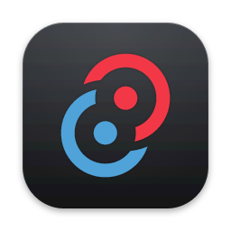
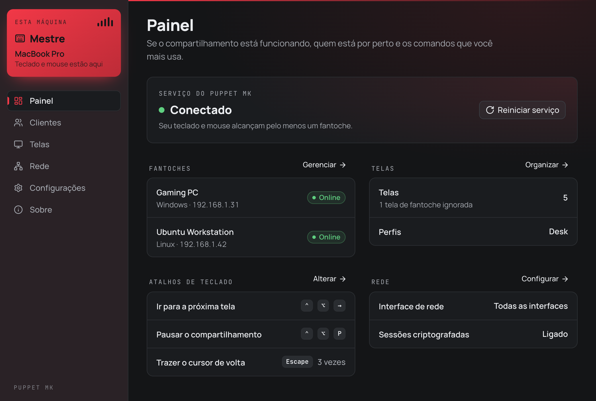
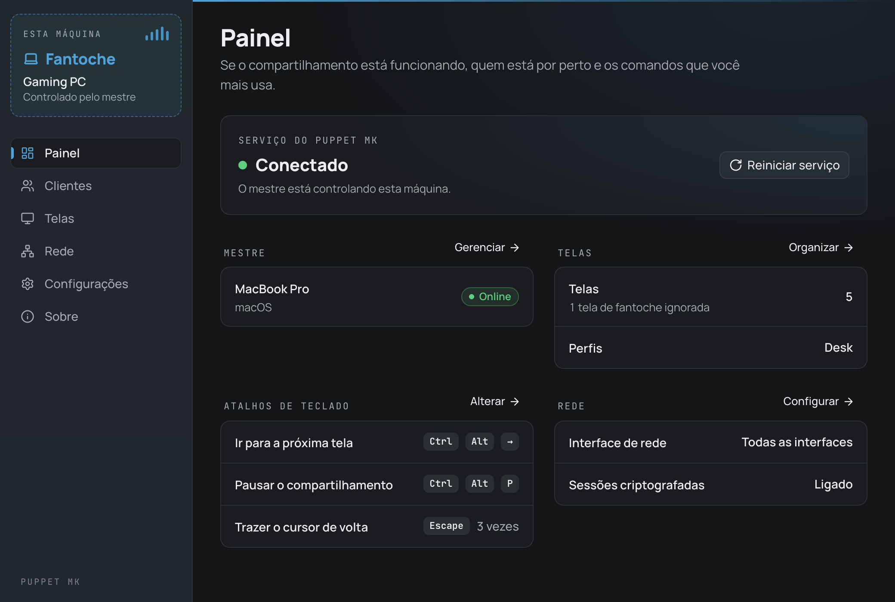
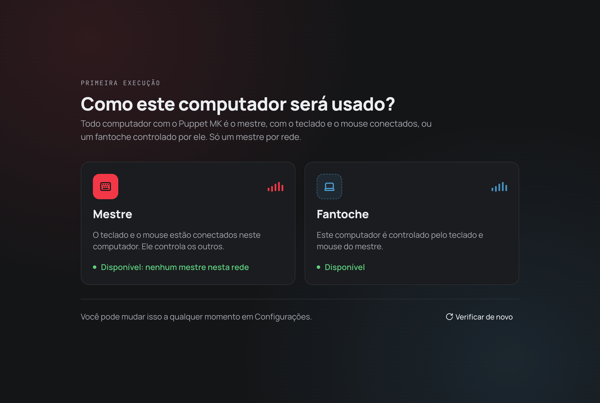
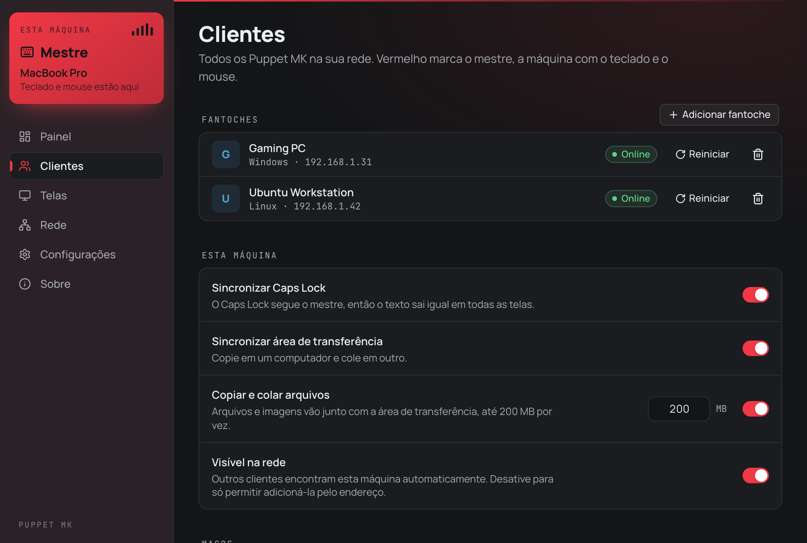
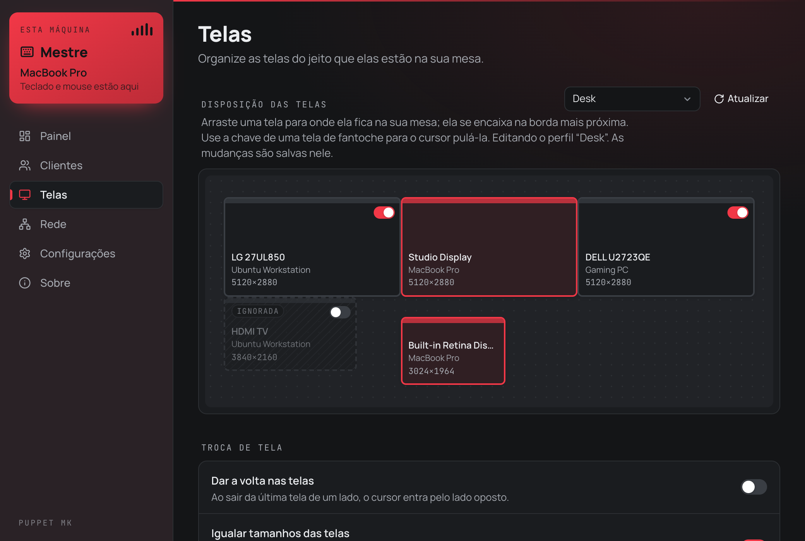
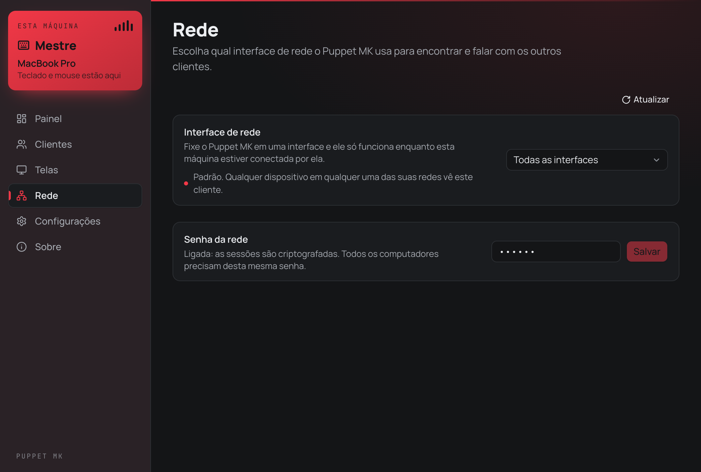
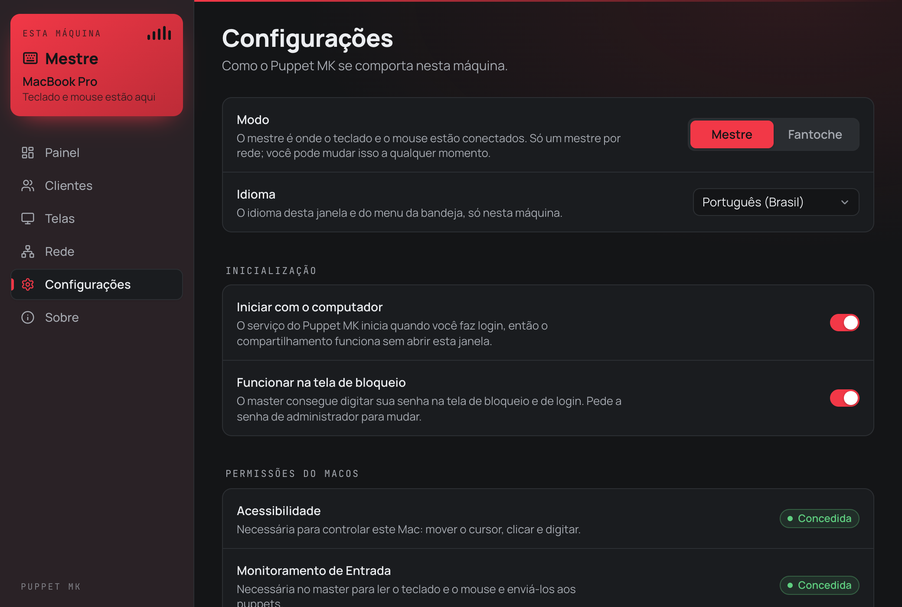

<p align="center">
  
</p>

<h1 align="center">Puppet Mouse Keyboard</h1>

<p align="center">
  <a href="https://github.com/danillo-ao/puppet-mk-releases/releases/latest"></a>
  <a href="https://github.com/danillo-ao/puppet-mk-releases/releases/latest"></a>
  <a href="https://github.com/danillo-ao/puppet-mk-releases/releases"></a>
  
  
  
  
</p>

<p align="center">
  <a href="readme.md">English</a> · <strong>Português (Brasil)</strong>
</p>

Compartilhe um único teclado e mouse entre todos os computadores da sua mesa, pela rede local.

Leve o cursor até a borda de uma tela e ele aparece no próximo computador, como se todas as máquinas fossem uma única área de trabalho. O teclado, o Caps Lock, a área de transferência e os arquivos vão junto. O Puppet MK funciona no **macOS**, no **Windows** e no **Linux**, e os computadores podem ter sistemas diferentes.



## Download

Baixe a versão mais recente na [página de Releases](../../releases/latest).

| Sistema | Arquivo |
| --- | --- |
| macOS (Apple Silicon) | `Puppet.MK_<versão>_aarch64.dmg` |
| Windows (64 bits) | `Puppet.MK_<versão>_x64-setup.exe` |
| Linux (64 bits, Debian / Ubuntu) | `Puppet.MK_<versão>_amd64.deb` |

Instale o Puppet MK em **todos** os computadores que vão compartilhar o teclado e o mouse.

## Como funciona

Cada computador com o Puppet MK é um **cliente**, e cada cliente tem um de dois papéis:

- **Mestre**: o computador com o teclado e o mouse conectados. Só existe um mestre por rede. Ele aparece em **vermelho**.
- **Fantoche**: um computador controlado pelo mestre. Ele aparece em **azul**.

Você pode trocar o papel a qualquer momento em **Configurações**.

| Mestre | Fantoche |
| --- | --- |
|  |  |

## Primeiros passos

1. **Instale** o Puppet MK em cada computador (veja [Observações por sistema](#observações-por-sistema)).
2. **Escolha um papel.** Na primeira abertura, o Puppet MK pergunta como o computador será usado. Escolha **Mestre** no computador com o teclado e o mouse, e **Fantoche** nos demais.

   

3. **Adicione os fantoches.** No mestre, abra **Clientes** e clique em **Adicionar fantoche**. Os fantoches da mesma rede são encontrados automaticamente; se algum não aparecer, adicione pelo endereço IP.
4. **Organize as telas.** Abra **Telas** e arraste cada tela para a posição em que ela está na sua mesa.
5. **Mova o mouse** pela borda da tela. Pronto.

## Recursos

### Clientes

O mestre lista todos os fantoches com o status de cada um, e pode reiniciar o serviço de um fantoche ou removê-lo. Cada máquina também define como se comporta:

- **Sincronizar Caps Lock**: o Caps Lock segue o mestre, e o texto sai igual em todas as telas.
- **Sincronizar área de transferência**: copie em um computador e cole em outro.
- **Copiar e colar arquivos**: arquivos e imagens vão junto com a área de transferência (até 200 MB por vez).
- **Visível na rede**: desligue para permitir que esta máquina seja adicionada só pelo endereço.
- **Teclas modificadoras no macOS**: remapeie Command, Control, Option e Shift. Por padrão, a tecla Windows funciona como Command.

As configurações feitas no mestre são sincronizadas com todos os clientes conectados.



### Telas

Arraste as telas para reproduzir a sua mesa; elas se encaixam na borda mais próxima. Telas com resoluções diferentes funcionam juntas.

- **Perfis**: salve vários arranjos (por exemplo *Mesa* e *Viagem*) e alterne entre eles.
- **Ignorar uma tela**: desligue a tela de um fantoche e o cursor passa direto por ela. Ela continua no arranjo, acinzentada.
- **Dar a volta nas telas** e **Igualar tamanhos das telas** para um movimento mais suave entre os monitores.



### Rede

- **Interface de rede**: por padrão, o Puppet MK funciona em qualquer rede. Fixe uma interface (por exemplo o Wi-Fi de casa) e ele só funciona enquanto estiver conectado por ela.
- **Senha da rede**: use a mesma senha em todos os computadores para criptografar as sessões.



### Configurações

- **Iniciar com o computador**: o serviço começa ao fazer login, sem abrir a janela.
- **Funcionar na tela de bloqueio**: o mestre pode digitar a sua senha na tela de bloqueio e de login (no macOS, pede a senha de administrador; no Linux, fica sempre ligado; ainda não disponível no Windows).
- **Impedir a troca**: mantém o cursor no computador atual nos cantos da tela, em apps em tela cheia, em janelas maximizadas ou **enquanto um botão do mouse está pressionado**, para que um arraste nunca pule para outro computador sem querer.
- **Atalhos de teclado**: ir para a próxima tela ou pausar o compartilhamento.
- **Tecla de pânico**: pressione uma tecla algumas vezes seguidas (por padrão `Esc` duas vezes) para trazer o cursor de volta ao centro da tela do mestre.
- **Idioma**: English ou Português (Brasil).
- **Atualizações**: procura e instala novas versões automaticamente.



### Barra de menus e bandeja

O Puppet MK continua rodando em segundo plano depois que você fecha a janela. O ícone na barra de menus do macOS, ou na bandeja do sistema no Windows e no Linux, mostra se o serviço está conectado, rodando ou parado.

## Observações por sistema

### macOS

1. Abra o `.dmg` e arraste o **Puppet MK** para **Aplicativos**.
2. Na primeira abertura, o macOS pode dizer que não consegue verificar o desenvolvedor. Vá em **Ajustes do Sistema → Privacidade e Segurança** e clique em **Abrir Mesmo Assim**.
3. Conceda as permissões que o Puppet MK pedir em **Ajustes do Sistema → Privacidade e Segurança**:
   - **Acessibilidade**: necessária para mover o cursor, clicar e digitar neste Mac.
   - **Monitoramento de Entrada**: necessária no mestre para ler o teclado e o mouse.

   Em **Configurações → Permissões do macOS**, o Puppet MK mostra se cada uma foi concedida.

As atualizações mantêm a mesma assinatura, então não é preciso conceder as permissões de novo depois de atualizar.

### Windows

1. Execute o instalador `-setup.exe`.
2. Se o Windows SmartScreen mostrar um aviso, clique em **Mais informações → Executar assim mesmo**.
3. Se o Firewall do Windows perguntar, permita o Puppet MK em redes privadas.

### Linux

1. Instale o pacote `.deb`:

   ```bash
   sudo apt install ./Puppet.MK_<versão>_amd64.deb
   ```

2. Saia da sessão e entre de novo. O pacote permite que o Puppet MK leia o teclado e o mouse e crie dispositivos virtuais, e isso passa a valer no próximo login.
3. O Puppet MK precisa de uma sessão X11, ou do XWayland no Wayland (já incluído na maioria dos ambientes de desktop).

Se o Puppet MK disser que não consegue ler nenhum teclado ou mouse, adicione o seu usuário ao grupo `input` (`sudo usermod -aG input $USER`) e entre de novo.

### Firewall

Os computadores se comunicam por estas portas, que precisam estar liberadas na rede local:

| Porta | Protocolo | Uso |
| --- | --- | --- |
| 47820 | UDP | Encontrar outros clientes |
| 47821 | TCP | Teclado, mouse, área de transferência e configurações |

## Atualização

O Puppet MK procura novas versões neste repositório. Abra **Sobre → Procurar atualizações**, ou ative as atualizações automáticas em **Configurações**. Você também pode baixar o novo instalador na [página de Releases](../../releases/latest) e instalar por cima da versão atual.

## Solução de problemas

- **Um fantoche não aparece**: confira se os dois computadores estão na mesma rede, se o firewall libera as portas acima e se **Visível na rede** está ligado. Você também pode adicionar o fantoche pelo endereço IP.
- **O cursor se move mas nada acontece no Mac**: confira **Configurações → Permissões do macOS**; a Acessibilidade precisa estar concedida.
- **O cursor ficou preso em outro computador**: use a tecla de pânico (por padrão `Esc` duas vezes) para trazê-lo de volta.
- **Algo parece estranho**: clique com o botão direito no ícone da bandeja ou da barra de menus e escolha **Reiniciar serviço**, ou use **Reiniciar serviço** no painel.
